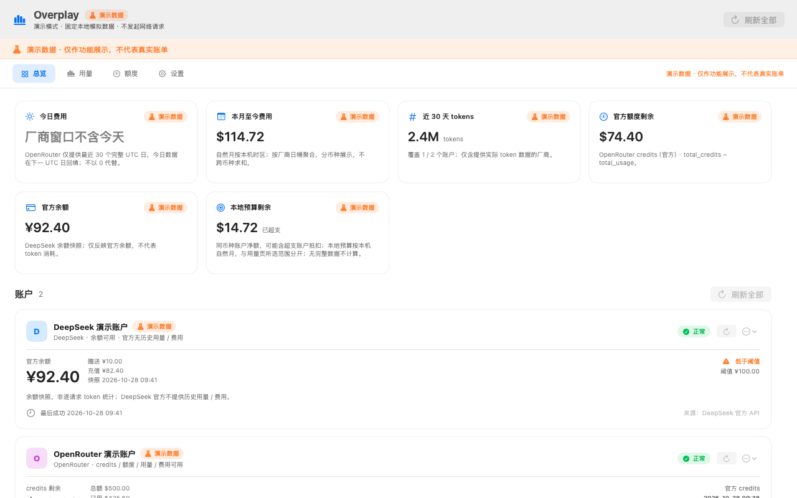
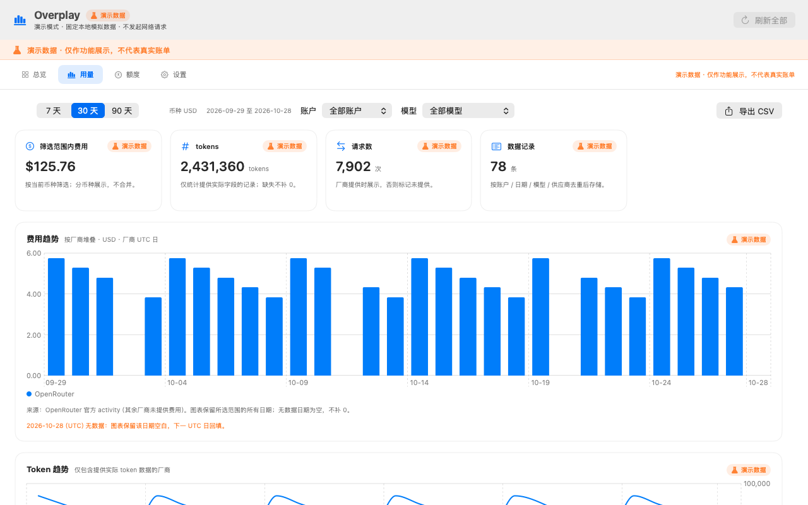
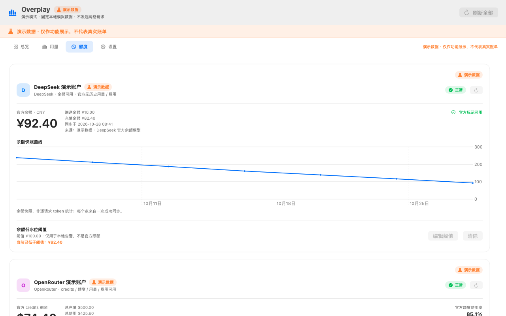
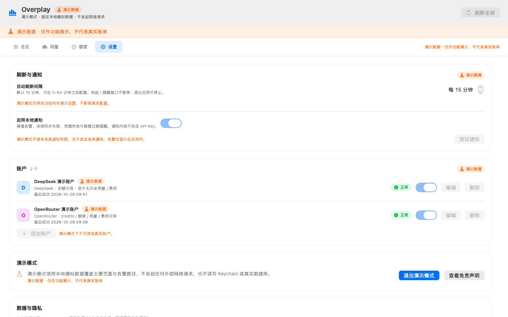
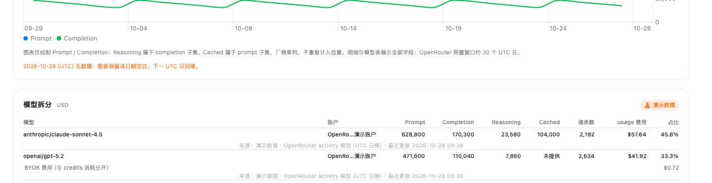
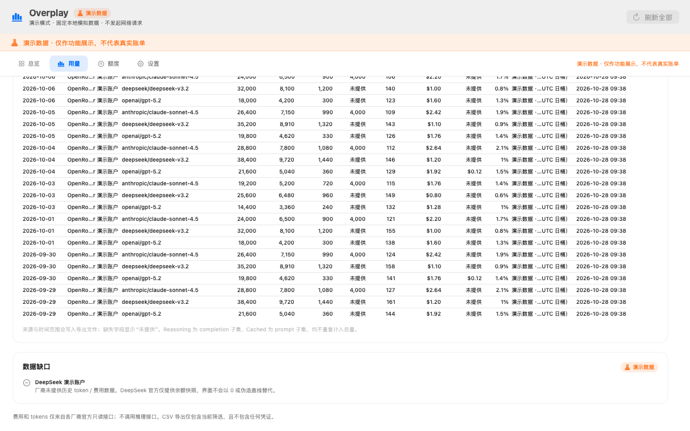
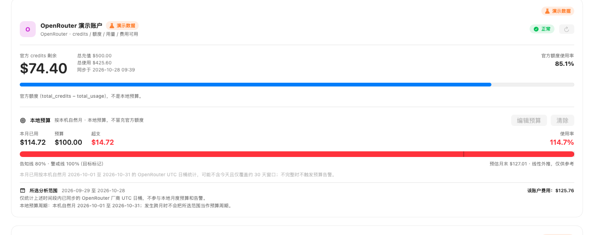

# Overplay（构建产物：DSOverplay.app）

macOS 14+ 菜单栏应用，统一查看 **DeepSeek** 与 **OpenRouter** 的官方余额、credits、近 30 天用量与费用，支持本地预算 / 余额低水位告警、余额快照曲线、CSV 导出、演示模式与本地持久化。

> 这个 demo 是用 DSH 测试开发的一个 demo，开源仅支持个人实践 / 学习，这个 demo 不可商用。
> This demo is developed and tested with DSH. It is open-source for personal practice and learning only. Commercial use of this demo is prohibited.

## 构建与运行

要求：macOS 14+、Apple Silicon、Swift 5.9+（Xcode 15+ 或 Command Line Tools）。运行测试需要完整 Xcode（XCTest 随 Xcode 提供）。

```bash
./build.sh                 # 生成 DSOverplay.app（ad-hoc 签名）
open DSOverplay.app        # 启动菜单栏应用
```

首次启动会展示引导。可添加 DeepSeek / OpenRouter 账户，或进入演示模式（需先确认免责声明）。菜单栏图标可打开摘要面板与主窗口；关闭主窗口只是隐藏，退出请使用面板 / 设置 / 托盘菜单中的「退出 Overplay」。

开发模式下可直接运行并输出调试信息：

```bash
./DSOverplay.app/Contents/MacOS/DSOverplay --demo --show
```

## 测试

```bash
./test.sh
```

`test.sh` 会在检测到 `/Applications/Xcode.app` 时自动设置 `DEVELOPER_DIR`，然后执行 `swift test`。当前测试覆盖：

- 金额 / 币种格式化、Decimal 精确累加、分币种聚合；
- 时间桶、时区与自然月边界、月末线性外推；
- SQLite 账户 / 快照 / 告警持久化，usage upsert 幂等与历史保留/删除；
- DeepSeek / OpenRouter 连接器的成功、401 / 403、429 + Retry-After、超时、空响应、畸形 JSON、缺失字段、BYOK 字段与部分成功；
- 预算 80% / 100%、余额低水位、连续同步失败、凭据失效、数据过期，以及去重、滞回与 6 小时冷却；
- 单账户 single-flight、凭据缺失、部分成功不触发预算告警；
- 自动刷新计时、启动错峰、5 分钟周期、指数退避、429 Retry-After 与凭据失效暂停重试；
- 部分成功/凭据失效时预算不可用（不显示 0 或完整剩余）、手动刷新取消与在途写入保护；
- 真实 `URLSession` 对 302 重定向的拒绝（本地一次性 HTTP 服务）；
- Keychain 实际读写（测试使用独立 service 并在结束时清理）；
- CSV 字段、转义、来源 / 时间范围 / 演示数据标识与无密钥。

## 功能范围

- **DeepSeek**：普通 API Key；`GET /user/balance` 读取总余额、赠送余额、充值余额与币种；每次成功同步保存快照，两次以上展示余额曲线。官方没有历史 token / 费用接口，界面明确显示「厂商未提供」，不会伪造为 0。
- **OpenRouter**：需要 **Management Key**；读取 `GET /api/v1/credits` 与 `GET /api/v1/activity`。按日 / 模型展示 prompt、completion、reasoning、缓存 tokens、请求数与 usage 费用；BYOK 费用单独标注；用量窗口约最近 30 个 UTC 日；普通 API Key 会得到“需要 Management Key”的可操作提示。
- **主看板**：总览、用量、额度、设置四个页签；7 / 30 / 90 天范围；按账户 / 模型筛选；费用按厂商堆叠、token 趋势、模型拆分、明细与占比；CSV 导出当前筛选。趋势图保留所选范围的全部日期，缺失日期留空且不补 0；当天无数据时直接显示空白并提示下一 UTC 日回填。
- **预算与告警**：OpenRouter 本地月度预算（80% / 100%）、DeepSeek 余额低水位、连续 3 次同步失败、凭据失效、超过 2 个刷新周期未成功同步；应用内告警历史 + 本地通知；同一预算阈值同月只触发一次，余额回升后重新布防，同步失败冷却 6 小时。
- **刷新**：全部 / 单账户手动刷新；自动刷新默认 15 分钟（5–60 分钟可配置）；指数退避与 Retry-After；同一账户 single-flight；同步不阻塞 UI。
- **演示模式**：内置 DeepSeek / OpenRouter 模拟数据与告警，覆盖主要页面；所有演示内容持续标注「演示数据」，导出文件带 `demo` 标记；**不发起外部网络请求、不读写 Keychain、不打开真实数据库**。演示用量模拟 OpenRouter 真实窗口（仅最近 30 个完整 UTC 日，不含今天），因此「今日费用」等当天视图会如实显示空状态。

界面效果（均为演示数据）：

| 总览 | 用量 |
| --- | --- |
|  |  |

| 额度 | 设置 |
| --- | --- |
|  |  |

| 模型拆分（含 reasoning / cached / 请求数） | 用量明细（滚动至表格） |
| --- | --- |
|  |  |

额度页将本机自然月预算与所选分析范围分开：预算使用率只按本机自然月统计，所选范围仅作独立参考，不参与告警。



另有引导页与深色模式截图：`docs/screenshots/onboarding.png`、`docs/screenshots/dark-overview.png`。

## 数据与安全

- 所有数据仅保存在本机：`~/Library/Application Support/Overplay/overplay.sqlite`（目录 0700，SQLite WAL）。
- API Key **只保存在 macOS Keychain**（`local.ds.overplay.credentials`，`AfterFirstUnlockThisDeviceOnly`，不随 iCloud 同步）；数据库、UserDefaults、日志、告警与 CSV 中不包含明文 Key。
- 请求仅发往 `api.deepseek.com` 与 `openrouter.ai` 的固定 HTTPS 接口；拒绝重定向；无遥测、无第三方统计、无远程配置；不调用推理接口、不代理 LLM 请求。
- 错误信息与厂商返回的错误摘要会脱敏 Authorization / Key；界面不提供 Key 明文回显。
- 退出时停止定时器、取消进行中的请求并退出；关闭主窗口不会退出应用。
- 删除账户会删除 Keychain 凭证，并提供「同时删除历史数据」选项（默认关闭，保留但不参与默认统计）。
- 「清除全部本地数据」需要两次确认，会删除账户、Keychain 凭证、历史用量、快照、告警与设置。演示模式需先退出，避免触碰真实数据。

## 演示模式

- 入口：首次引导或设置页；进入前展示完整免责声明，取消则不进入。
- 演示数据位于内存命名空间，不读取真实账户或凭证；不启动同步引擎，因此不会产生任何外部请求。
- 演示用量与 OpenRouter 官方窗口一致：仅最近 30 个完整 UTC 日，不含今天；趋势图保留所选范围最后一天的空位并给出提示，不隐藏、不补 0。
- 导出 CSV 文件名含 `demo`，内容含「是否演示数据」列与「演示数据」标识；演示告警不会发送系统通知。
- 演示模式会持久化开关；下次启动仍为演示模式，所有页面继续显示演示标识。退出后回到真实模式。

## 已知限制

- 本 Issue 仅接入 DeepSeek 与 OpenRouter；OpenAI / Anthropic / Azure / Google / 内部网关连接器未实现。
- DeepSeek 无历史用量 / 费用接口，只能展示余额快照，不提供 token 趋势或百分比额度。
- OpenRouter activity 仅覆盖最近约 30 个 UTC 日；超出窗口不显示、不补 0。费用 / token 趋势图保留所选范围的全部日期，缺失日期留空；当天数据通常要到下一 UTC 日才可见。OpenRouter 金额为 USD，credits 与本地预算分开展示。
- 月度预算按本机自然月聚合厂商 UTC 日桶，可能不含当天且仅覆盖约 30 天窗口；数据不完整时不触发预算告警。额度页同时展示「所选分析范围」的独立统计，并明确其不参与本地月度预算；发生跨月时不会把所选范围当作预算周期。预估值为线性外推，仅作参考。
- 首版仅 Apple Silicon 构建；未提供 DMG、签名公证、自动更新与随系统启动。
- 不支持跨币种换算或统一总额；不同币种分开展示。

## 目录结构

```text
Sources/OverplayCore/   # 存储、Keychain、连接器、同步、告警、演示数据、CSV
Sources/OverplayApp/    # AppKit 生命周期、菜单栏、SwiftUI 主看板
Tests/OverplayCoreTests # XCTest 单元与集成测试（fixtures / mock transport）
docs/screenshots/       # 演示数据截图
build.sh                # 构建 .app
test.sh                 # 运行测试
```
