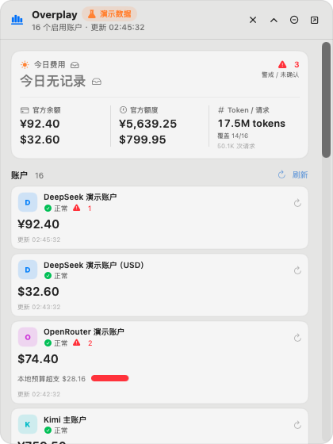
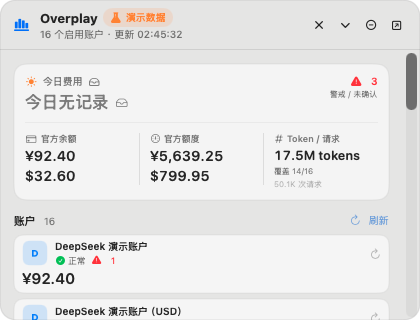
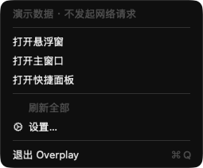
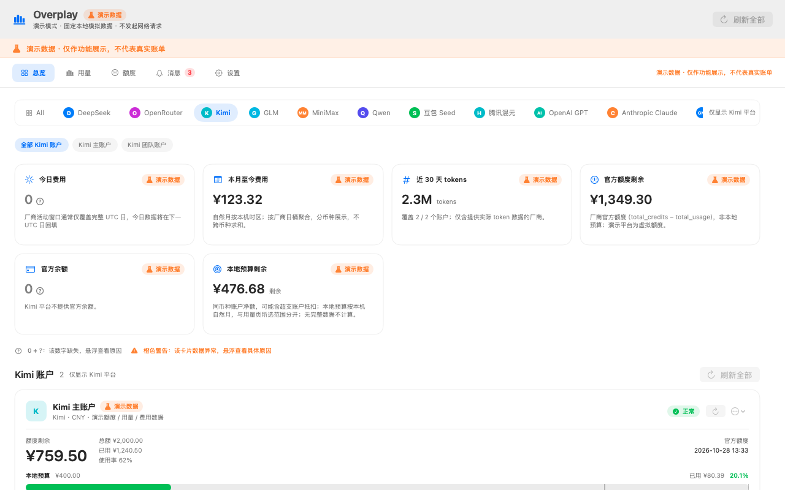
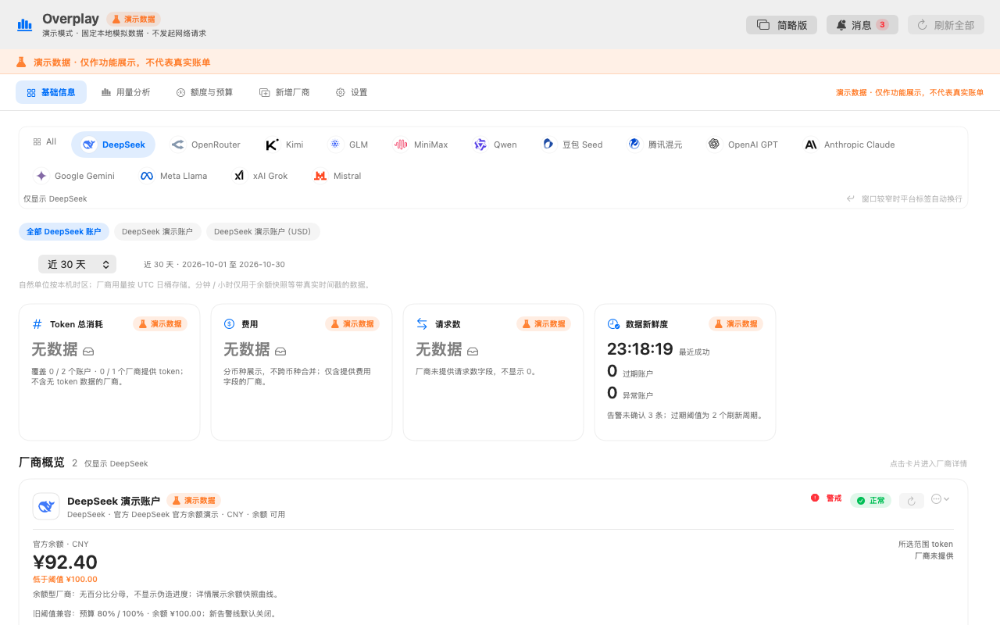
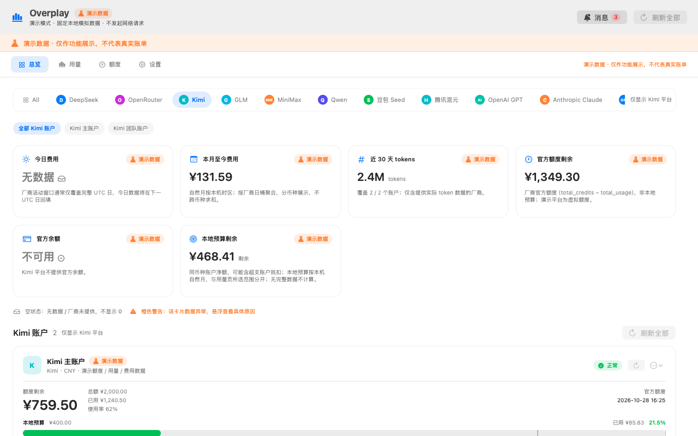
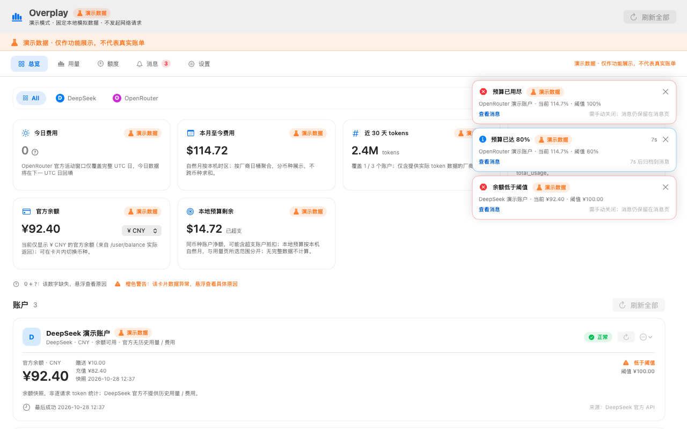
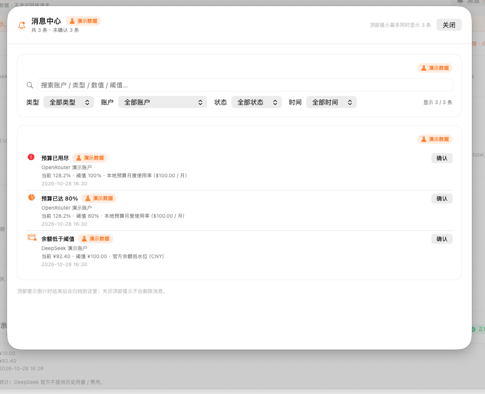

# Overplay（构建产物：DSOverplay.app）

macOS 14+ 菜单栏应用，提供常驻的**简略版悬浮窗**与**完整版主窗口**：悬浮窗用于快速查看今日费用、余额 / 额度、tokens 与告警，主窗口用于完整分析、额度、消息与设置。支持本地预算 / 余额低水位告警、余额快照曲线、CSV 导出、演示模式与本地持久化。**真实连接器仅支持 DeepSeek 与 OpenRouter**；演示模式额外提供 Kimi、GLM、MiniMax、Qwen、豆包 Seed、腾讯混元、OpenAI GPT、Anthropic Claude、Google Gemini、Meta Llama、xAI Grok、Mistral 的虚拟数据，用于演示多平台 / 多账户 / 跨币种展示。

> 这个 demo 是用 DSH 测试开发的一个 demo，开源仅支持个人实践 / 学习，这个 demo 不可商用。
> This demo is developed and tested with DSH. It is open-source for personal practice and learning only. Commercial use of this demo is prohibited.

## 构建与运行

要求：macOS 14+、Apple Silicon、Swift 5.9+（Xcode 15+ 或 Command Line Tools）。运行测试需要完整 Xcode（XCTest 随 Xcode 提供）。

```bash
./build.sh                 # 生成 DSOverplay.app（ad-hoc 签名）
open DSOverplay.app        # 启动菜单栏应用
```

首次启动会先展示 issue-001 的引导；完成或关闭引导后显示简略版悬浮窗，后续启动直接恢复上次的悬浮窗位置、宽度、密度与收起状态。真实模式可添加 DeepSeek / OpenRouter 账户；演示模式（需先确认免责声明）内置 14 个平台的虚拟账户。`--show` 可直接打开完整版主窗口。菜单栏图标左键 / 双击打开或前置悬浮窗，右键显示菜单；关闭主窗口只是隐藏。

开发模式下可直接运行并输出调试信息：

```bash
./DSOverplay.app/Contents/MacOS/DSOverplay --demo --show
```

## 测试

```bash
./test.sh
```

`test.sh` 会在检测到 `/Applications/Xcode.app` 时自动设置 `DEVELOPER_DIR`，然后执行 `swift test`。当前测试覆盖：

- 金额 / 币种格式化、Decimal 精确累加、分币种聚合；
- 时间桶、时区与自然月边界、月末线性外推；
- SQLite 账户 / 快照 / 告警持久化，usage upsert 幂等与历史保留/删除；
- DeepSeek / OpenRouter 连接器的成功、401 / 403、429 + Retry-After、超时、空响应、畸形 JSON、缺失字段、BYOK 字段与部分成功；
- 预算 80% / 100%、余额低水位、连续同步失败、凭据失效、数据过期，以及去重、滞回与 6 小时冷却；
- 单账户 single-flight、凭据缺失、部分成功不触发预算告警；
- 自动刷新计时、启动错峰、5 分钟周期、指数退避、429 Retry-After 与凭据失效暂停重试；
- 部分成功/凭据失效时预算不可用（不显示 0 或完整剩余）、手动刷新取消与在途写入保护；
- 真实 `URLSession` 对 302 重定向的拒绝（本地一次性 HTTP 服务）；
- Keychain 实际读写（测试使用独立 service 并在结束时清理）；
- CSV 字段、转义、来源 / 时间范围 / 演示数据标识与无密钥；
- 数据状态：真实 0、缺失、不可用、部分成功、失败 / 凭据失效、厂商余额异常；
- 平台 / 账户范围聚合、跨币种隔离、额度与预算排除不完整账户、币种选项与默认选择；
- 消息筛选、未确认计数、顶部队列上限、error 不自动消失、80% 倒计时与归档；
- 演示数据 14 平台 / 16 账户 / 每账户 30 个完整 UTC 日且不含今天；
- 悬浮窗位置 / 宽度 / 密度 / 收起状态持久化与多显示器钳制、简略版字段映射、退出清理顺序；
- 状态项演示标识在有未确认告警时仍保持可见，以及告警级别的符号 / 可访问性映射。

当前共 **128 项 XCTest**，全部通过。

另提供应用内自动化验证：`--demo --switch-smoke` 覆盖主窗口 / 悬浮窗切换、折叠、收起、消息中心与托盘面板路径，断言 0 次刷新调用与 0 个网络请求；`--demo --collapse-floating --auto-quit-after N` 用于收起后空闲 CPU 采样。

## 功能范围

- **DeepSeek**：普通 API Key；`GET /user/balance` 读取总余额、赠送余额、充值余额与币种；每次成功同步保存快照，两次以上展示余额曲线。每个账户显示官方返回的账户币种；总览的「官方余额」卡片内提供紧凑币种下拉（如 `¥ CNY` / `$ USD`），默认 CNY，仅当当前范围实际返回多个币种时显示；选择 USD 账户会自动切到 USD，只显示所选币种，不混合其他币种。余额阈值只作用于当前账户，币种跟随该账户；不同币种账户分开统计。官方没有历史 token / 费用接口，界面明确显示「厂商未提供」，不会伪造为 0。
- **OpenRouter**：需要 **Management Key**；读取 `GET /api/v1/credits` 与 `GET /api/v1/activity`。按日 / 模型展示 prompt、completion、reasoning、缓存 tokens、请求数与 usage 费用；BYOK 费用单独标注；用量窗口约最近 30 个 UTC 日；普通 API Key 会得到“需要 Management Key”的可操作提示。
- **简略版悬浮窗**：无边框、置顶、非激活式、可拖动的常驻窗口；支持完整 / 压缩两档密度。顶部四个按钮为退出、折叠、收起、打开完整版；全局摘要显示今日费用（分币种）、官方余额 / 额度、Token 总量与覆盖率、请求数、告警状态 / 未确认数与最后同步时间；账户列表固定状态栏、内部滚动。缺失数据使用空状态，不显示 0。收起后仅保留托盘，轮询与告警继续；重启恢复位置、宽度、密度与收起状态，屏幕变化后自动钳制到可见区域。
- **托盘**：菜单栏状态项常驻，左键 / 双击打开或前置悬浮窗（收起时恢复），右键菜单提供打开悬浮窗、打开主窗口、打开快捷面板、刷新全部、设置与退出。图标使用模板 SF Symbol（矢量图，系统按菜单栏 16 / 18 / 22 / 44 px 与 @2x 自动渲染，无位图裁切），按正常 / 告知 / 警戒 / 失败切换形状与颜色，并提供 tooltip。演示模式无论是否有未确认告警，状态项都固定显示“演示”文字标识，右键菜单顶部固定显示“演示数据 · 不发起网络请求”，不会把演示告警误认为真实数据。
- **简略 / 完整双向切换**：悬浮窗“打开完整版”或编辑按钮打开主窗口；主窗口“简略版”按钮或关闭主窗口返回悬浮窗（若未收起）；托盘同时提供两个入口，复用同一数据 / 同步 / 告警引擎，不重建数据或重复请求。
- **主看板**：完整版主窗口保留总览、用量、额度、设置四个页签（本 issue 不新增五 Tab / 基础信息 / 新增厂商）；消息中心是顶部 / 总览面板，不占用独立 Tab。总览顶部按已有账户生成平台按钮（All / 各平台，横向滚动），选中平台后账户列表与费用、tokens、官方余额、credits、本地预算都按平台过滤；平台内有多个账户时显示“全部 / 指定账户”chips，名称使用用户自定义账户名。跨平台、跨币种不混算。7 / 30 / 90 天范围；按账户 / 模型筛选；费用按厂商堆叠、token 趋势、模型拆分、明细与占比；CSV 导出当前筛选。趋势图保留所选范围的全部日期，缺失日期留空且不补 0；当天无数据时直接显示空白并提示下一 UTC 日回填。
- **数据状态**：只有厂商明确返回 0 时才显示真实的 0；缺失、不可用、未同步、部分成功、同步失败或凭据失效显示「无数据 / 不可用 / 暂无完整数据 / 同步失败」等空状态与原因，不使用 `0`、`0?` 或 `0%` 占位。部分成功 / 缺失数据不参与预算、额度使用率或阈值告警计算。
- **消息中心**：顶部最多同时显示 3 条消息并叠加显示，不挤压布局；error 类消息（预算已用尽、余额低于阈值、同步失败、凭据失效）需手动关闭，预算 80% 通知倒计时后归档，普通告知倒计时后关闭，不显示进度条。消息中心从顶部消息、总览或额度页打开，支持搜索、类型 / 账户 / 状态 / 时间筛选、确认与未确认计数；Overview / Quota 不再各自维护旧告警列表。演示来源消息持续标注「演示数据」。
- **预算与告警**：本地月度预算（80% / 100%；真实模式当前为 OpenRouter，演示模式还覆盖 Kimi、GLM、Qwen、OpenAI、Anthropic、Mistral）、DeepSeek 余额低水位、连续 3 次同步失败、凭据失效、超过 2 个刷新周期未成功同步；应用内消息中心 + 本地通知；同一预算阈值同月只触发一次，余额回升后重新布防，同步失败冷却 6 小时。
- **刷新**：全部 / 单账户手动刷新；自动刷新默认 15 分钟（5–60 分钟可配置）；指数退避与 Retry-After；同一账户 single-flight；同步不阻塞 UI。
- **退出**：悬浮窗关闭、托盘、设置页、菜单栏与系统退出统一清理；停止定时器 / 请求、保存窗口状态、关闭窗口并移除托盘；无未保存内容时不额外阻断退出。
- **演示模式**：悬浮窗、托盘和主窗口共享 14 个平台 / 16 个账户、30 个完整 UTC 日的虚拟数据与告警；DeepSeek 含 CNY / USD 两个账户，Kimi 含主账户 / 团队账户；其余平台包括 OpenRouter、GLM、MiniMax、Qwen、豆包 Seed、腾讯混元、OpenAI GPT、Anthropic Claude、Google Gemini、Meta Llama、xAI Grok、Mistral。所有演示内容持续标注「演示数据」，导出文件带 `demo` 标记；**不发起外部网络请求、不读写 Keychain、不打开真实数据库**。演示用量仅覆盖最近 30 个完整 UTC 日（不含今天），因此「今日费用」等当天视图会如实显示空状态。

界面效果（均为演示数据）：

| 简略版悬浮窗（展开） | 简略版悬浮窗（压缩） |
| --- | --- |
|  |  |

| 托盘右键菜单（演示标识） | 总览（All / 平台栏，含“简略版”入口） |
| --- | --- |
|  |  |

| 演示托盘标识（浅色系统外观） | 演示托盘标识（深色系统外观） |
| --- | --- |
|  |  |

| 平台选中与账户 chips | 官方余额币种下拉（DeepSeek All） |
| --- | --- |
|  |  |

| 空状态：无数据 / 不可用 | 设置 |
| --- | --- |
|  |  |

| 顶部消息（最多 3 条；error 手动关闭） | 消息中心面板（无独立 Tab，可筛选 / 确认） |
| --- | --- |
|  |  |

| 用量（多平台堆叠） | 额度 |
| --- | --- |
|  |  |

额度页按账户展示 DeepSeek 币种与阈值，两个账户的 CNY / USD 余额不会合并；部分成功或缺失数据不计算使用率 / 剩余 / 预估。

另有引导页与深色模式截图：`docs/screenshots/onboarding.png`、`docs/screenshots/dark-overview.png`。

## 数据与安全

- 所有数据仅保存在本机：`~/Library/Application Support/Overplay/overplay.sqlite`（目录 0700，SQLite WAL）。
- API Key **只保存在 macOS Keychain**（`local.ds.overplay.credentials`，`AfterFirstUnlockThisDeviceOnly`，不随 iCloud 同步）；数据库、UserDefaults、日志、告警与 CSV 中不包含明文 Key。
- 请求仅发往 `api.deepseek.com` 与 `openrouter.ai` 的固定 HTTPS 接口；拒绝重定向；无遥测、无第三方统计、无远程配置；不调用推理接口、不代理 LLM 请求。
- 错误信息与厂商返回的错误摘要会脱敏 Authorization / Key；界面不提供 Key 明文回显。
- 退出时停止定时器、取消进行中的请求并退出；关闭主窗口不会退出应用。
- 删除账户会删除 Keychain 凭证，并提供「同时删除历史数据」选项（默认关闭，保留但不参与默认统计）。
- 「清除全部本地数据」需要两次确认，会删除账户、Keychain 凭证、历史用量、快照、告警与设置。演示模式需先退出，避免触碰真实数据。

## 演示模式

- 入口：首次引导或设置页；进入前展示完整免责声明，取消则不进入。
- 演示数据位于内存命名空间，不读取真实账户或凭证；不启动同步引擎，因此不会产生任何外部请求。
- 演示数据覆盖 14 个平台、16 个账户，每个有用量数据的账户都包含 30 个完整 UTC 日（不含今天）；趋势图保留所选范围最后一天的空位并给出提示，不隐藏、不补 0。
- 演示平台只有虚拟数据与能力声明，真实账户编辑器仍只允许 DeepSeek / OpenRouter；未接入平台由 `UnsupportedConnector` 明确拒绝，不会发起真实请求。
- 导出 CSV 文件名含 `demo`，内容含「是否演示数据」列与「演示数据」标识；演示告警不会发送系统通知。
- 演示模式会持久化开关；下次启动仍为演示模式，所有页面继续显示演示标识。退出后回到真实模式。

## 已知限制

- 真实连接器仅接入 DeepSeek 与 OpenRouter。Kimi、GLM、MiniMax、Qwen、豆包 Seed、腾讯混元、OpenAI GPT、Anthropic Claude、Google Gemini、Meta Llama、xAI Grok、Mistral 目前只有演示虚拟数据，没有同步引擎、凭据校验或真实接口；真实模式账户编辑器不允许添加这些平台。接入真实平台需要后续连接器 issue。
- DeepSeek 无历史用量 / 费用接口，只能展示余额快照，不提供 token 趋势或百分比额度。
- OpenRouter activity 仅覆盖最近约 30 个 UTC 日；超出窗口不显示、不补 0。费用 / token 趋势图保留所选范围的全部日期，缺失日期留空；当天数据通常要到下一 UTC 日才可见。OpenRouter 金额为 USD，credits 与本地预算分开展示。
- DeepSeek 每个账户只设置一个余额低水位阈值，币种必须与该账户余额接口返回的币种一致；若一个账户返回多个币种，可在这些币种中选择一个作为该账户的阈值。不同账户 / 币种不合并统计。
- 月度预算按本机自然月聚合厂商 UTC 日桶，可能不含当天且仅覆盖约 30 天窗口；数据不完整时不触发预算告警。额度页同时展示「所选分析范围」的独立统计，并明确其不参与本地月度预算；发生跨月时不会把所选范围当作预算周期。预估值为线性外推，仅作参考。
- 首版仅 Apple Silicon 构建；未提供 DMG、签名公证、自动更新与随系统启动。
- 不支持跨币种换算或统一总额；不同币种分开展示。

## 目录结构

```text
Sources/OverplayCore/   # 存储、Keychain、连接器、同步、告警、演示数据、CSV
Sources/OverplayApp/    # AppKit 生命周期、菜单栏、SwiftUI 主看板
Tests/OverplayCoreTests # XCTest 单元与集成测试（fixtures / mock transport）
docs/screenshots/       # 演示数据截图
build.sh                # 构建 .app
test.sh                 # 运行测试
```
